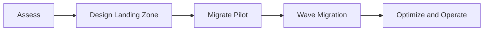

# On-prem to Azure Migration Landing Zone

This repository documents the landing-zone and migration approach required to move enterprise applications and infrastructure into Azure with clear phases, governance, and operational readiness.

